  
  
  
  

## ✦ Featured project

<table>
<tr>
<td>

### 📍 Locus: Rental Housing Law Navigator

**Pick any building and see which housing laws apply, each one traced to the exact sentence of law.**
An LLM extracts rule records from statutes, and every quote is checked verbatim against the source before it is stored. Addresses resolve to their *legal* city, and each rule gets a three-valued result: when a fact is missing, Locus answers `unknown` instead of guessing.

`CA · NJ · MA` &nbsp; `EN / ES` &nbsp; `cited to the sentence` &nbsp; `no live LLM at answer time`

   

**[▶ Live demo](https://rental-law-navigator.vercel.app)** &nbsp;·&nbsp; **[Repository](https://github.com/syedwajiulhassan715-rgb/Locus)** &nbsp;·&nbsp; Hack-Nation Global Hackathon · RealPage challenge

</td>
</tr>
</table>

## ✦ Selected work

<table>
<tr>
<td width="50%" valign="top">

### 🩺 ECHO
**Longitudinal clinical-AI ward command center**

Turns routine observations into replayable patient trajectories. It escalates only on persistent or corroborated change, then prepares evidence-backed actions for a human to approve.

`event sourcing` `deterministic replay` `human-in-the-loop` `390 tests`

TypeScript · Next.js · Node.js · Corti APIs &nbsp;|&nbsp; Corti Hackathon

</td>
<td width="50%" valign="top">

### 🤖 VLA Robustness Analysis
**Does OpenVLA know when it is about to fail?**

1,200 LIBERO episodes under visual and language perturbations. Success drops from **81% → 12%** when the instruction referent is removed, while action confidence stays at **~0.78**: the model fails confidently.

`OpenVLA` `LIBERO` `robustness` `research paper`

Python · PyTorch · CUDA

</td>
</tr>
<tr>
<td width="50%" valign="top">

### 🏭 Semiconductor Process Control
**SPC and root-cause screening on 1,567 real fab runs**

A standard p-chart misses a real 3× yield improvement (12.92% → 4.11%, p = 2×10⁻⁹) that a CUSUM catches. 16 of 17 "root causes" turn out to be a time confound, and the published prediction baseline fails an honest split.

`87 tests` `23s deterministic pipeline` `decision log D1–D24`

Python · SciPy · Power BI star schema · UCI SECOM

</td>
<td width="50%" valign="top">

### 🦷 Fonio Refill Agent
**Voice AI that refills cancelled appointments in about a minute**

When a patient cancels, the agent ranks the waitlist with explainable scores, calls the best candidate through Fonio, and keeps looping until the slot is booked, with no one at the desk picking up a phone.

`idempotent orchestration` `webhooks` `attempt ledger`

Next.js · TypeScript · Prisma · SQLite &nbsp;|&nbsp; START Hack Vienna '26

</td>
</tr>
</table>

<b>More projects</b>

 

| Project | What it does | Stack |
| :-- | :-- | :-- |
| 📈 [**U.S. Macroeconomic Indicators**](https://github.com/syedwajiulhassan715-rgb/U.S-Macroeconomic-Indicators) | Eight FRED series, 2000–2026. Fed rate peaks lead unemployment peaks by ~32–35 months, and rate transmission is much faster post-COVID | pandas · Plotly · SciPy |
| 🔎 [**TraceCause**](https://github.com/syedwajiulhassan715-rgb/Trace-Cause) *(WIP)* | Injects faults into a microservice system and ranks the root-cause service from OpenTelemetry traces. The LLM only explains; it never decides | Java · OpenTelemetry · Postgres · React |
| 📰 [**AI Signal Feed**](https://github.com/syedwajiulhassan715-rgb/signal-feed) | Daily briefing from arXiv, Hacker News and newsletters, ranked by an LLM and emailed every morning | Python · Groq · RSS |
| ⚖️ [**GitHub Comparator**](https://github.com/syedwajiulhassan715-rgb/github-comparator) | Paste up to 5 repos and get an AI side-by-side comparison | Python · GitHub API · Groq |
| 📚 [**arXiv Digest**](https://github.com/syedwajiulhassan715-rgb/arxiv-digest) | Topic-based paper digest delivered by email | Python · arXiv API |

## ✦ How I build

<table>
<tr>
<td width="50%" valign="top">

**🧠 AI Systems:** agents, LLM integrations, evaluation, workflow automation 
**🔬 Applied ML:** robustness experiments, VLA evaluation, empirical analysis 
**⚙️ Backend:** APIs, event-driven systems, state machines, persistence

</td>
<td width="50%" valign="top">

**🖥️ Product:** Next.js and React human-in-the-loop interfaces 
**📊 Data:** statistical testing, SPC, BI modelling, visual analysis 
**🔁 Automation:** Python pipelines, scheduled jobs, data aggregation

</td>
</tr>
</table>

## ✦ Tech stack

**Languages & ML** 

**Web & Backend** 

**Data & Infra** 

## ✦ Currently exploring

- 🦾 Vision-Language-Action models and embodied AI
- 🧾 Reliable, auditable AI agents
- 📏 Evaluation methods for AI systems
- 🔁 AI-native workflow automation

## ✦ GitHub activity

  
  
    
  <picture>
    <source media="(prefers-color-scheme: dark)" srcset="https://raw.githubusercontent.com/syedwajiulhassan715-rgb/syedwajiulhassan715-rgb/output/github-snake-dark.svg"/>
    
  </picture>

---

### Build useful systems. Measure whether they actually work.

