  
  
  

🏆 **1st** Hack-Nation Global AI Hackathon, Linz hub &nbsp;·&nbsp; **1st** AIM Healthcare Hackathon Vienna, clinical documentation (IBM challenge) 
**Winner** proximata Vienna &nbsp;·&nbsp; **Talona track winner** Building Better Worlds Hackathon 2026

## ✦ Featured project

<table>
<tr>
<td>

### 🤖 VLA Robustness Analysis: does OpenVLA know when it is about to fail?

**1,200 LIBERO episodes under visual and language perturbations.**
Success drops from **81% to 12%** when the instruction's referent is removed, yet mean action confidence stays near **0.78** in every condition and barely separates success from failure. The model fails confidently, so a runtime monitor watching that signal would see nothing wrong.

`OpenVLA` `LIBERO` `robustness` `failure prediction` `research paper`

  

**[Repository and paper](https://github.com/syedwajiulhassan715-rgb/vla-robustness-analysis)**

</td>
</tr>
</table>

## ✦ Selected work

<table>
<tr>
<td width="50%" valign="top">

### 🩺 ECHO
**Longitudinal clinical-AI ward command center**

Turns routine observations into replayable patient trajectories. It escalates only on persistent or corroborated change, then prepares evidence-backed actions for a human to approve.

`event sourcing` `deterministic replay` `human-in-the-loop` `390 tests`

TypeScript · Next.js · Node.js · Corti APIs &nbsp;|&nbsp; Corti Hackathon

</td>
<td width="50%" valign="top">

### 📍 Locus
**Rental housing law, traced to the sentence**

Pick any building and see which housing laws apply. Every quote the LLM extracts is checked verbatim against the statute before it is stored, and a missing fact gives `unknown` instead of a guess. **[▶ Live demo](https://rental-law-navigator.vercel.app)**

`cited to the sentence` `CA · NJ · MA` `EN / ES` `no live LLM at answer time`

Python · FastAPI · TypeScript · Vercel &nbsp;|&nbsp; Hack-Nation · RealPage challenge

</td>
</tr>
<tr>
<td width="50%" valign="top">

### 🏭 Semiconductor Process Control
**SPC and root-cause screening on 1,567 real fab runs**

A standard p-chart misses a real 3× yield improvement (12.92% → 4.11%, p = 2×10⁻⁹) that a CUSUM catches. 16 of 17 "root causes" turn out to be a time confound, and the published prediction baseline fails an honest split.

`423 tests` `CI` `decision log D1–D45` `live demo`

Python · SciPy · Power BI star schema · UCI SECOM

</td>
<td width="50%" valign="top">

### 🦷 Fonio Refill Agent
**Voice AI that refills cancelled appointments in about a minute**

When a patient cancels, the agent ranks the waitlist with explainable scores, calls the best candidate through Fonio, and keeps looping until the slot is booked, with no one at the desk picking up a phone.

`idempotent orchestration` `webhooks` `attempt ledger`

Next.js · TypeScript · Prisma · SQLite &nbsp;|&nbsp; START Hack Vienna '26

</td>
</tr>
</table>

<b>More projects</b>

 

| Project | What it does | Stack |
| :-- | :-- | :-- |
| 📈 [**U.S. Macroeconomic Indicators**](https://github.com/syedwajiulhassan715-rgb/U.S-Macroeconomic-Indicators) | Eight FRED series, 2000–2026. Fed rate peaks lead unemployment peaks by ~32–35 months, and rate transmission is much faster post-COVID | pandas · Plotly · SciPy |
| 🔎 [**TraceCause**](https://github.com/syedwajiulhassan715-rgb/Trace-Cause) *(WIP)* | Injects faults into a microservice system and ranks the root-cause service from OpenTelemetry traces. The LLM only explains; it never decides | Java · OpenTelemetry · Postgres · React |
| 📰 [**AI Signal Feed**](https://github.com/syedwajiulhassan715-rgb/signal-feed) | Daily briefing from arXiv, Hacker News and newsletters, ranked by an LLM and emailed every morning | Python · Groq · RSS |
| ⚖️ [**GitHub Comparator**](https://github.com/syedwajiulhassan715-rgb/github-comparator) | Paste up to 5 repos and get an AI side-by-side comparison | Python · GitHub API · Groq |
| 📚 [**arXiv Digest**](https://github.com/syedwajiulhassan715-rgb/arxiv-digest) | Topic-based paper digest delivered by email | Python · arXiv API |

## ✦ How I build

<table>
<tr>
<td width="50%" valign="top">

**🧠 AI Systems:** agents, LLM integrations, evaluation, workflow automation 
**🔬 Applied ML:** robustness experiments, VLA evaluation, empirical analysis 
**⚙️ Backend:** APIs, event-driven systems, state machines, persistence

</td>
<td width="50%" valign="top">

**🖥️ Product:** Next.js and React human-in-the-loop interfaces 
**📊 Data:** statistical testing, SPC, BI modelling, visual analysis 
**🔁 Automation:** Python pipelines, scheduled jobs, data aggregation

</td>
</tr>
</table>

## ✦ Tech stack

**Languages & ML** 

**Web & Backend** 

**Data & Infra** 

## ✦ Currently

- 🦾 Vision-Language-Action models and embodied AI, at JKU's Institute of Pervasive Computing and on the TU Wien Robotics Club VLA team
- 🧾 Reliable, auditable AI agents
- 📏 Evaluation methods for AI systems
- 🔁 AI-native workflow automation
- 💼 Open to AI/ML internships and working-student roles in Vienna / Austria

---

### Build useful systems. Measure whether they actually work.

